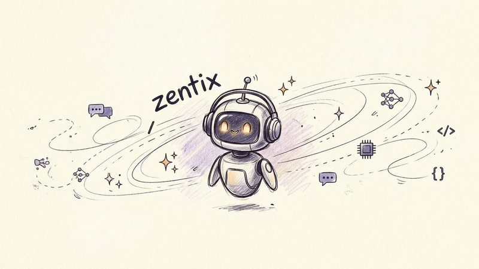

<p align="center">
  
</p>

<h1 align="center">ZentixBot</h1>
<p align="center">A self-hosted Discord bot for communities, with a dashboard and AI features.</p>
<p align="center">
  
  
  
  <a href="https://discord.gg/v7cBZBUFm9"></a>
</p>

> **Status:** this project is preparing for beta. The owner has tested some workflows on Discord, but not every combination of features, providers and hosting has been verified. Use a test server and back up data before relying on the bot.

[Bahasa Indonesia](README.md) · **English**

**[Features](#features) · [Requirements](#requirements) · [Getting started](#getting-started) · [Dashboard & AI](#dashboard--ai) · [Data & backups](#data--backups) · [Documentation](#documentation)**

## Features

| Area | Available features |
| --- | --- |
| **Community** | Welcome and goodbye messages, self roles, Join to Create, birthdays, server stats, leveling, Activities points and giveaways. |
| **Tickets & moderation** | Inbox, forms, claim transfers, transcripts, limited response/SLA reminders and optional auto-close; AutoMod, anti-raid, logging and moderation commands. |
| **Message Studio** | Create and manage messages with Discord components, previews and scheduling. |
| **AI Studio** | Channel and DM chat, FAQ, translation, link summaries, images, activities and configurable AI community features. |
| **Music & utilities** | Music through Lavalink, search, dictionaries and server utilities. |
| **Dashboard** | Configure the bot and its features through a web interface running in the same process. |

Feature availability depends on configuration, Discord permissions and external services. One Zentix instance serves **one server** through `GUILD_ID`; it is not a public multi-server bot.

## Requirements

- **Node.js 22.13+**; use **22.16+** for SQLite backups.
- A Discord bot application and a test server. Enable the **Server Members** and **Message Content** intents and grant the bot the permissions it needs.
- SQLite is available by default; PostgreSQL can be configured optionally.
- Hosting with persistent storage and **HTTPS** access for the dashboard.

> **Important:** by default, at each startup the bot deletes global commands on the same Discord application, except the Activity entry point. Use a dedicated application for Zentix or set `KEEP_GLOBAL_COMMANDS=true` before starting if other global commands must be retained.

## Getting started

In the repository folder:

```bash
npm ci --omit=dev
cp .env.example .env
# Configure .env or the hosting environment privately
npm start
```

Set at least `DISCORD_TOKEN`, `CLIENT_ID` and `GUILD_ID`. For dashboard token login, also set `OWNER_IDS` and `DASHBOARD_TOKEN`. Add provider keys only for the features you use. All variables and their descriptions are in [`.env.example`](.env.example).

> Never share `.env`, bot tokens, dashboard tokens, API keys or database URLs. On a hosting panel, `PORT` in `.env.example` can take precedence over the panel's `SERVER_PORT`; remove or adjust it if necessary.

## Dashboard & AI

Open `https://your-dashboard-address/dashboard/` and sign in with the dashboard token, or use a configured Discord login. Anyone who knows the dashboard token can use it; do not share token-bearing login links. Public HTTP does not encrypt tokens or sessions.

AI is configured in **AI Studio**. To let members generate images, configure an image provider and the AI foundation, then enable **Image Studio → Discord**, select channels and optional roles, and set a cooldown. Members use `/gambar` with consent. This feature is off by default; content filtering depends on the provider and does not guarantee safe results.

Processed content is sent to external providers and may consume quota or incur charges. Inform members before enabling features that read channels. Long-term DM memory is opt-in and managed by each member; do not store sensitive data. Link summaries do not execute JavaScript, and scanned PDFs or videos cannot always be read.

Members can use `/terjemahkan` with text, a target language and consent to post the result in the channel. The command uses the AI provider and daily quota, independently of automatic translation and flag-reaction settings. Do not submit sensitive data.

## Data & backups

Without database configuration, the bot uses SQLite at `data/zentix.db`. When PostgreSQL is configured, database data is stored in PostgreSQL; the bot does not automatically migrate data or switch databases if the connection fails. Keep data and backups in a persistent, secure location—backups may contain personal data and are not encrypted.

**Test recovery from a backup copy on a separate target before relying on it.** `restore:db` is intentionally disabled at present. Do not test restoration against a production database.

## Documentation

- 📖 [Read the ZentixBot Wiki](https://github.com/wahanggaaa-code/zentixbot-ai-aio/wiki) (currently in Indonesian).
- [Contributing & reporting bugs](CONTRIBUTING.md) · [Security policy](SECURITY.md) · [MIT License](LICENSE).

The `tests/`, `.github/` and `docs/` folders exist only in the working repository, not in the public clean copy. Tests run in the working repository before publication.
