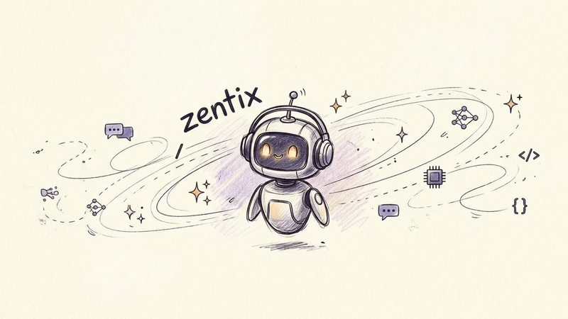

<p align="center">
  
</p>

<p align="center">
  <a href="https://github.com/discordjs/discord.js"></a>
  <a href="https://nodejs.org/"></a>
  <a href="https://github.com/wahanggaaa-code/zentixbot-ai-discord"></a>
</p>

# ZentixBot

> Menggabungkan komunitas dan AI menjadi satu bot yang nyaman digunakan.

Bot Discord untuk satu server, dengan dashboard web di proses yang sama. Ditulis dengan discord.js dan Express. Data disimpan di SQLite (berkas yang dibuat bot sendiri, tanpa pemasangan apa pun) atau di PostgreSQL.

> **Status pengujian:** bot ini diuji secara lokal dengan Discord tiruan, provider AI tiruan dan database sementara. Di hosting sungguhan, dari log dan tangkapan layar pemilik bot (13–14 November 2026), yang terlihat berjalan adalah startup, pendaftaran perintah slash, dashboard setelah login, dan `/aichat`. Fitur lain belum diperiksa di sana.

**Daftar isi:** [Fitur](#fitur) · [Kebutuhan](#kebutuhan) · [Menjalankan](#menjalankan) · [Variabel lingkungan](#variabel-lingkungan) · [Database](#database) · [Docker](#docker) · [Port](#port) · [Dashboard](#dashboard) · [Fitur AI](#fitur-ai) · [Musik](#musik) · [Bila ada masalah](#bila-ada-masalah) · [Susunan folder](#susunan-folder) · [Berkontribusi](#berkontribusi) · [Lisensi](#lisensi)

## Fitur

Perintah slash dikelompokkan per kategori di `src/commands/`:

AI · Birthday · Core · Giveaway · Join to Create · Leveling · Logging · Moderation · Music · Reaction Roles · Search · Server Stats · Social Alerts · Ticket · Tools · Utility

Dashboard web dibuka di `/dashboard/`. Seluruh kategori diatur dari sana — AI lewat AI Studio. Search, Utility dan Tools sengaja tidak punya halaman sendiri karena tidak menyimpan pengaturan server; ketiganya tetap tersedia sebagai perintah di Discord.

Social Alerts (Fitur → Social Alerts) mengumumkan upload video / Shorts / live YouTube dan live Twitch ke channel pilihan, dengan jeda tiap feed, mention role opsional dan ringkasan AI opsional. Kuncinya: `YOUTUBE_API_KEY` (YouTube Data API v3, gratis, ±2 unit kuota per feed per pemeriksaan tiap 10 menit) untuk YouTube, `TWITCH_CLIENT_ID` + `TWITCH_CLIENT_SECRET` untuk Twitch. Tanpa kunci, feed tetap tersimpan tapi tidak diperiksa — halamannya menyebutkan kunci mana yang belum diisi. Jujur soal batasannya: deteksi Shorts dan live tidak 100% akurat, dan thumbnail live Twitch sering berupa placeholder. Tombol **Tes** di dashboard mengirim pesan sungguhan ke channel target (tanpa mention, termasuk @everyone).

## Kebutuhan

- Node.js 22.13 ke atas bila memakai SQLite (pilihan bawaan). Dengan PostgreSQL, Node.js 20.10 ke atas.
- Database: tidak perlu disiapkan. Tanpa pengaturan database, bot membuat berkas SQLite `data/zentix.db` di folder bot.
- Aplikasi di Discord Developer Portal dengan dua intent khusus dinyalakan: Server Members dan Message Content.
- Disk sekitar 175 MB setelah `npm ci`.

## Menjalankan

```bash
npm ci
cp .env.example .env    # lalu isi nilainya
npm start
```

Saat startup bot membuat berkas database dan tabelnya sendiri, lalu mendaftarkan perintah slash ke server yang disebut di `GUILD_ID`.

Di panel hosting bergaya Pterodactyl: pilih image Node 22, arahkan ke repository ini dengan berkas utama `index.js`, dan isi variabel di tab Startup → Environment. Langkah panel ini diambil dari panduan pihak lain dan belum diperiksa sendiri.

## Variabel lingkungan

Wajib:

| Variabel | Isi |
| --- | --- |
| `DISCORD_TOKEN` | Token bot |
| `CLIENT_ID` | Application ID |
| `GUILD_ID` | ID satu server yang dilayani bot |
| `NODE_ENV` | `production` di hosting |

Disarankan:

| Variabel | Isi |
| --- | --- |
| `OWNER_IDS` | ID Discord pemilik bot. Halaman AI dan pemakaian sistem di dashboard hanya untuk ID ini. Tombol kontak di `/help` dan `/support` membuka profil ID pertama |
| `DASHBOARD_TOKEN` | Rahasia minimal 12 karakter untuk login dashboard |
| `AI_GROQ_API_KEY`, `AI_GEMINI_API_KEY`, `AI_OPENROUTER_API_KEY`, `AI_NVIDIA_API_KEY` | Minimal satu bila fitur AI dipakai |
| `NODE_OPTIONS` | `--max-old-space-size=384` pada container 512 MB. Diisi di panel, bukan di `.env`. Pemakaian memori bot belum pernah diukur |

Daftar lengkap beserta keterangannya ada di `.env.example`.

## Database

Bot memilih database dari isi `.env`, sekali saat startup:

| Isi `.env` | Database yang dipakai |
| --- | --- |
| Tidak ada pengaturan database | SQLite di `data/zentix.db` (folder dan berkasnya dibuat otomatis) |
| `DATABASE_PATH=/lokasi/zentix.db` | SQLite di lokasi itu |
| `POSTGRES_URL=...` (atau `POSTGRES_HOST` dan kawan-kawannya) | PostgreSQL |

Baris pertama log startup menyebut database yang dipakai, misalnya `Database: SQLite, data is kept in the file /home/container/data/zentix.db`.

Yang perlu diketahui:

- **Seluruh data bot ada di folder `data/`.** Folder itu tidak ikut di Git. Saat mengunggah ulang kode, jangan menimpa atau menghapusnya.
- **Folder `data/` harus bertahan saat restart.** Di layanan yang membuat ulang container setiap deploy, arahkan `DATABASE_PATH` ke volume persisten atau pakai PostgreSQL.
- Bot tidak pernah berpindah database sendiri. Bila PostgreSQL sudah diatur tetapi tidak dapat dihubungi, bot berhenti dengan `POSTGRES_UNAVAILABLE`.
- Data tidak disalin antara SQLite dan PostgreSQL. Pindah database berarti mulai dari data kosong.
- Bila pengaturan menunjuk ke dua database sekaligus, bot berhenti dan meminta `DATABASE_ENGINE=sqlite` atau `DATABASE_ENGINE=postgresql`.
- Satu berkas SQLite untuk satu proses bot. Untuk beberapa proses, pakai PostgreSQL.
- `ExperimentalWarning: SQLite is an experimental feature` di log berasal dari Node.js dan bukan galat.
- `/ready` menjawab 200 bila database dapat dipakai, dan 503 bila tidak.

### Cadangan dan pemulihan (SQLite)

Mencadangkan, salah satu:

1. **Saat bot menyala:** `npm run backup:db`. Hasilnya satu berkas `backups/zentix-<waktu>.db`. Perlu Node 22.16 ke atas. Lokasi lain: `npm run backup:db -- --backup-dir /lokasi` atau variabel `BACKUP_DIR`.
2. **Saat bot berhenti:** salin seluruh folder `data/`, termasuk `zentix.db-wal` dan `zentix.db-shm` bila ada.

Jangan menyalin `zentix.db` saja saat bot menyala: perubahan terbaru masih berada di berkas `-wal`.

Memulihkan:

1. Hentikan bot.
2. Kosongkan folder `data/`.
3. Salin berkas cadangan ke `data/zentix.db`.
4. Nyalakan bot.

Simpan cadangan di luar server bot. Berkas cadangan berisi seluruh data bot tanpa enkripsi.

### Latihan pemulihan

Backup belum bisa dipercaya sebelum pernah dicoba. Perintah berikut menyalin berkas backup ke folder sementara, memeriksanya (benar-benar database Zentix, `integrity_check` ok, tabel dan isinya terhitung), lalu menghapus salinannya. Berkas backup tidak diubah dan bot tidak perlu menyala:

```bash
npm run restore:drill:sqlite -- --input backups/zentix-TANGGAL-HEX.db
```

Bila perintah ini gagal, jangan pakai berkas itu untuk pemulihan.

## Docker

`docker-compose.yml` menjalankan bot bersama PostgreSQL. Bila image dijalankan sendiri tanpa PostgreSQL, data ada di `/usr/src/app/data` di dalam container dan hilang saat container dibuat ulang, kecuali folder itu dipasang sebagai volume:

```bash
docker run -v zentix-data:/usr/src/app/data ...
```

Image ini belum pernah dibangun atau dijalankan dalam pengujian. Image memakai user non-root (`node`) dan `HEALTHCHECK` ke `/health`; untuk monitoring dengan cek database, pakai `/ready`.

## Port

Bot memakai nilai pertama yang sah dari `WEB_PORT`, `PORT`, `SERVER_PORT`, dalam urutan itu. Bila tidak ada yang diisi, port 3000.

- `SERVER_PORT` diisi sendiri oleh panel bergaya Pterodactyl, jadi di sana port tidak perlu diatur manual.
- `.env.example` berisi `PORT=3000`. Bila berkas itu disalin apa adanya, `PORT` menang atas `SERVER_PORT`. Hapus baris `PORT` atau isi dengan port dari panel.
- Log startup menyebut dari mana port diambil, misalnya `Web port 16954 taken from SERVER_PORT`.

## Dashboard

### Login dengan token (cara termudah)

1. Isi `DASHBOARD_TOKEN` dengan rahasia buatan sendiri, minimal 12 karakter. Huruf dan angka saja paling mudah.
2. Isi `OWNER_IDS` dengan ID akun Discord pemilik. Akun itu harus anggota server yang dilayani bot.
3. Mulai ulang bot, buka `http://IP:PORT/dashboard/`, ketik token, tekan Masuk.

Alamat `http://IP:PORT/masuk/TOKEN` langsung masuk tanpa mengetik.

- **Siapa pun yang tahu token dapat memakai dashboard**, termasuk fitur moderasi. Jangan kirim token atau tautan login lewat chat atau tangkapan layar: aplikasi chat membuka tautan untuk membuat pratinjau.
- Untuk mengganti token, ubah `DASHBOARD_TOKEN` lalu mulai ulang bot. Semua sesi ikut berakhir.
- Dashboard bertindak atas nama akun pertama di `OWNER_IDS`. Begitu akun itu keluar dari server, sesi ditolak.
- Sesi berlaku 12 jam dan hilang saat bot dimulai ulang.
- Lewat `http://`, token dan sesi berjalan tanpa enkripsi. Pihak di jaringan yang sama dapat membacanya. Pakai `https://` bila hosting menyediakannya, lalu isi `DASHBOARD_URL` dengan alamat itu.
- Bila `DASHBOARD_URL` diisi, login hanya diterima dari alamat itu, jadi isinya harus sama dengan alamat yang dibuka.

Bila halaman login menolak:

| Pesan | Sebab |
| --- | --- |
| "Token salah." | Yang diketik tidak sama dengan `DASHBOARD_TOKEN`, atau bot belum dimulai ulang setelah `.env` diubah |
| "… DASHBOARD_TOKEN harus minimal 12 karakter." | Token terlalu pendek |
| "… isi OWNER_IDS …" | `OWNER_IDS` kosong atau bukan ID Discord (17 sampai 20 angka) |
| "Akun di OWNER_IDS (…) bukan anggota server …" | ID itu bukan anggota server pada `GUILD_ID` |
| "Login hanya diterima dari …" | Dashboard dibuka lewat alamat yang berbeda dari `DASHBOARD_URL` |
| "Bot belum siap memverifikasi server." | Bot belum tersambung ke Discord; tunggu sampai log menulis ONLINE |
| "Terlalu banyak percobaan login dari alamat ini." | Batas 30 percobaan per 15 menit tercapai; tunggu selama yang disebut pesan itu |

### Login lewat Discord

Hanya owner server dan pemegang izin Administrator yang dapat masuk. Isi `DISCORD_CLIENT_SECRET` dan `DASHBOARD_URL` (alamat dashboard tanpa path), lalu tambahkan `<DASHBOARD_URL>/dashboard/callback` di Discord Developer Portal → OAuth2 → Redirects.

Bawaannya login ini hanya aktif pada alamat `https://`. Untuk panel yang hanya memberi `http://IP:PORT`, isi juga `DASHBOARD_ALLOW_HTTP=true`; sesi lalu berjalan tanpa enkripsi dan halaman Pengaturan menampilkan catatan "Tanpa enkripsi". Login ini sampai masuk ke dashboard lewat `http://` belum terkonfirmasi di hosting sungguhan.

### Pemakaian sistem

Halaman ringkasan menampilkan CPU, RAM, jaringan dan disk kontainer tanpa pengaturan apa pun. Kuota disk tidak bisa dibaca dari dalam kontainer: isi `DISK_LIMIT_MB` (misalnya `5120` untuk 5 GB) agar batangnya terisi.

## Fitur AI

Kunci provider diisi di `.env`. Semua pengaturan lain ada di dashboard, **AI Studio**, khusus akun di `OWNER_IDS`.

- **Provider chat:** Groq, Gemini, OpenRouter dan NVIDIA NIM. Di **Provider & fallback** dipilih satu provider utama dan sampai tiga cadangan. Provider tanpa kunci di `.env` dilewati tanpa pesan; baris "Kunci server" di halaman itu menunjukkan kunci mana yang terbaca.
- **Kapan bot pindah ke cadangan:** provider tidak menjawab dalam batas waktu, jaringan gagal, atau jawabannya 401, 403, 404, 408, 429 atau 5xx. Bila provider menolak isi permintaan, cadangan tidak dicoba.
- **Kuota harian** dihitung satu kali per permintaan: bawaan 20 per anggota dan 200 per server. Pekerjaan otomatis bot (ronde Activities, koran pagi) memakai kuota atas nama bot sendiri, jadi naikkan batas per anggota bila jadwalnya lebih dari 20 permintaan per hari.
- **Pesan anggota dikirim ke provider AI** pada fitur yang membaca channel (AI interaktif, terjemahan otomatis), tanpa persetujuan per pesan. Beri tahu anggota.
- **Server Builder → Bongkar bersifat permanen:** channel dihapus beserta pesannya. Belum pernah dijalankan pada Discord sungguhan; coba dulu di server uji.

Transkrip suara, pencarian web dan gambar memakai layanan tersendiri:

| Fitur | Variabel pilihan | Nilai | Yang harus diisi |
| --- | --- | --- | --- |
| Transkrip suara | `AI_AUDIO_PROVIDER` | `openai` (bawaan) | `AI_AUDIO_API_KEY`, `AI_AUDIO_MODEL` |
| | | `groq` | `AI_GROQ_API_KEY`; `AI_AUDIO_MODEL` boleh kosong, dan nama model OpenAI ditolak Groq |
| Pencarian web | `AI_SEARCH_PROVIDER` | `brave` (bawaan) | `AI_BRAVE_SEARCH_KEY` |
| | | `tavily` | `AI_TAVILY_API_KEY` |
| Gambar | `AI_IMAGE_PROVIDER` | `openai` (bawaan) | `AI_IMAGE_API_KEY`, `AI_IMAGE_MODEL` |
| | | `cloudflare` | `AI_CLOUDFLARE_API_TOKEN`, `AI_CLOUDFLARE_ACCOUNT_ID` |
| | | `pollinations` | Tidak ada |

Nilai yang salah ketik mematikan fitur itu, dan log startup menyebutkannya. Edit gambar hanya tersedia dengan OpenAI. Dengan Pollinations, instruksi menjadi bagian alamat web yang dapat dibuka siapa pun, jadi jangan dipakai untuk hal pribadi.

## Musik

Tidak memerlukan variabel. Bot memakai node Lavalink publik milik pihak ketiga yang tercantum di `lavalink/nodes.json`; node seperti itu dapat mati atau menolak kapan saja. Untuk menggantinya, ubah berkas itu atau isi `LAVALINK_NODES`.

## Bila ada masalah

- **Bot diam atau fitur tidak jalan:** baca log. Baris `WARN` dan `ERROR` menyebut sebabnya, misalnya `AI interactive: reply skipped (Semua provider gagal atau timeout.)`. `LOG_LEVEL=info` menambah kejadian biasa, `LOG_LEVEL=debug` menambah rincian.
- **Konsol panel menampilkan kode seperti `[32m`:** isi `NO_COLOR=1`.
- **Perintah `/…` menjawab "that command does not exist":** perintah itu milik program lain yang pernah memakai aplikasi Discord yang sama. Bot menghapus perintah global seperti itu setiap kali start; tutup dan buka lagi aplikasi Discord bila masih ditawarkan. `KEEP_GLOBAL_COMMANDS=true` mematikan penghapusan ini.
- **Perintah slash baru tidak muncul:** bot sudah mendaftarkan 100 perintah, batas Discord per server. Perintah ke-101 tidak terdaftar.
- **Dashboard menjawab "Too many requests":** batasnya per alamat IP, yaitu 600 permintaan per menit untuk dashboard dan 30 percobaan login per 15 menit. Di belakang reverse proxy, semua pengunjung terhitung sebagai satu alamat.
- **Node lebih lama dari 22.13:** bot berhenti dengan `SQLite needs Node.js 22.13 or newer`. Ganti image ke Node 22 atau isi `POSTGRES_URL`.

## Susunan folder

| Folder | Isi |
| --- | --- |
| `src/` | Kode bot: perintah, event, layanan, dashboard API |
| `dashboard/` | Antarmuka dashboard (HTML, CSS dan JavaScript tanpa proses build) |
| `scripts/` | Migrasi, backup dan restore |
| `lavalink/` | Daftar node musik dan konfigurasi Lavalink mandiri |

## Berkontribusi

Cara melapor bug dan mengusulkan perubahan ada di [`CONTRIBUTING.md`](CONTRIBUTING.md). Celah keamanan dilaporkan secara tertutup; lihat [`SECURITY.md`](SECURITY.md).

## Lisensi

MIT. Lihat [`LICENSE`](LICENSE).
